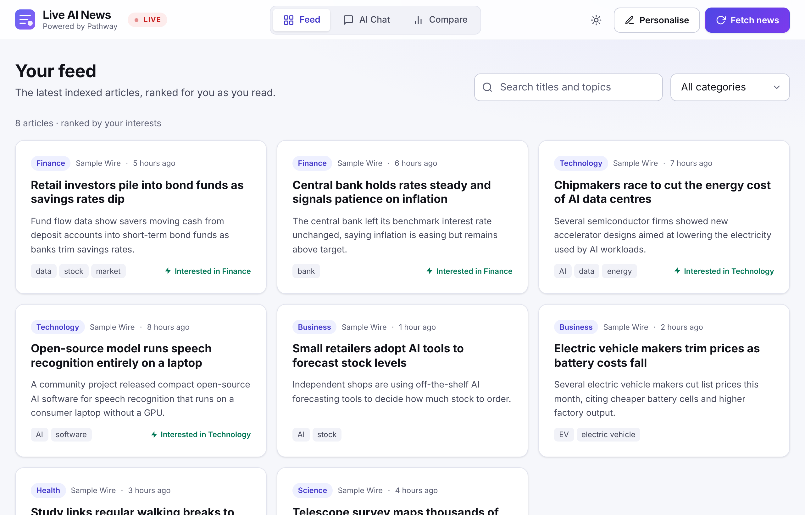
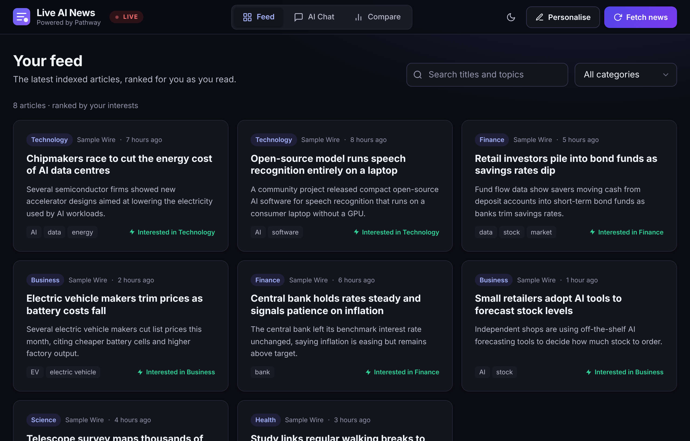
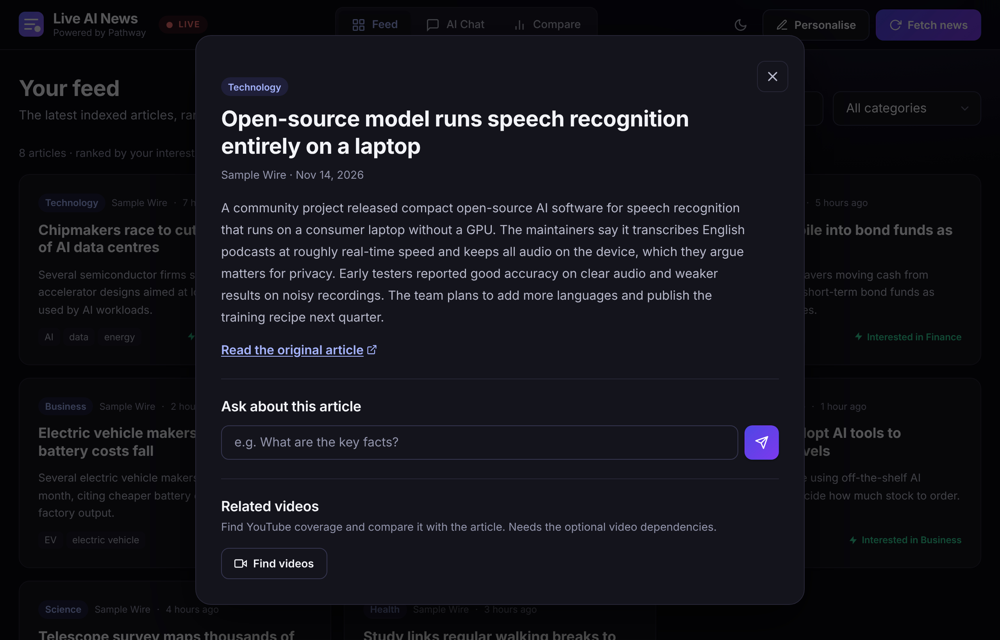
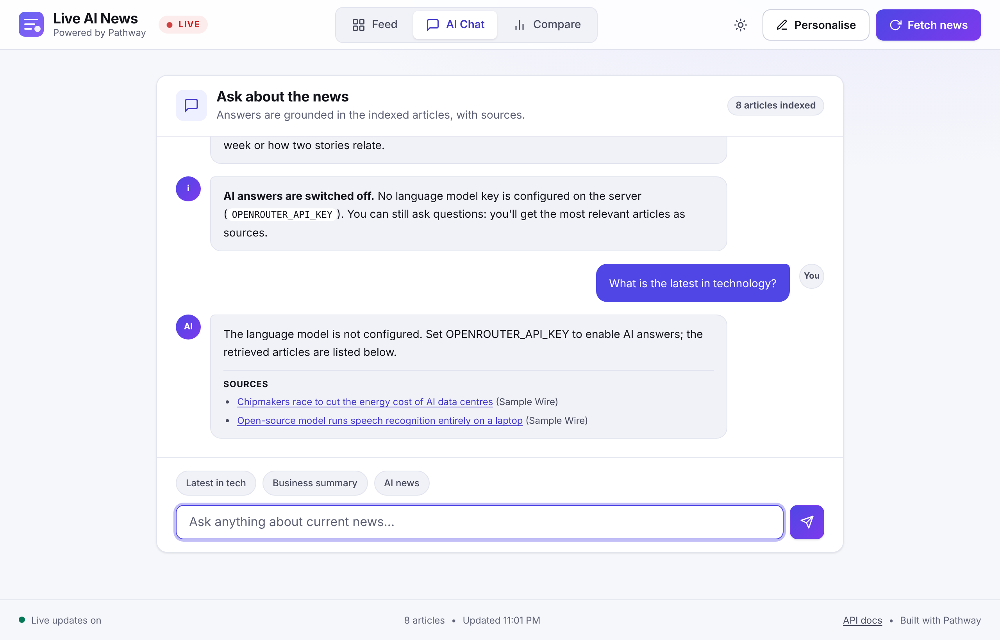
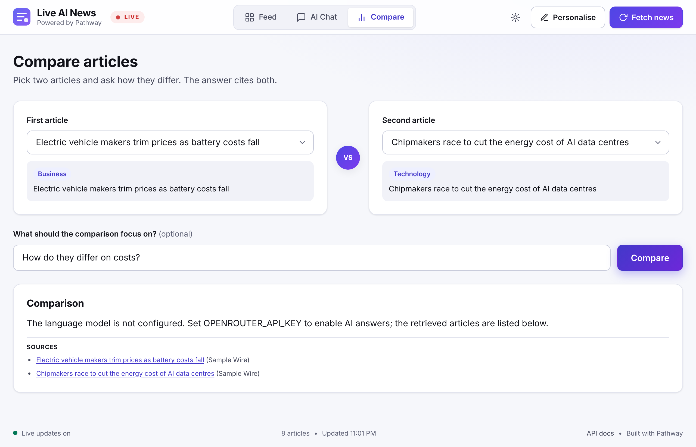
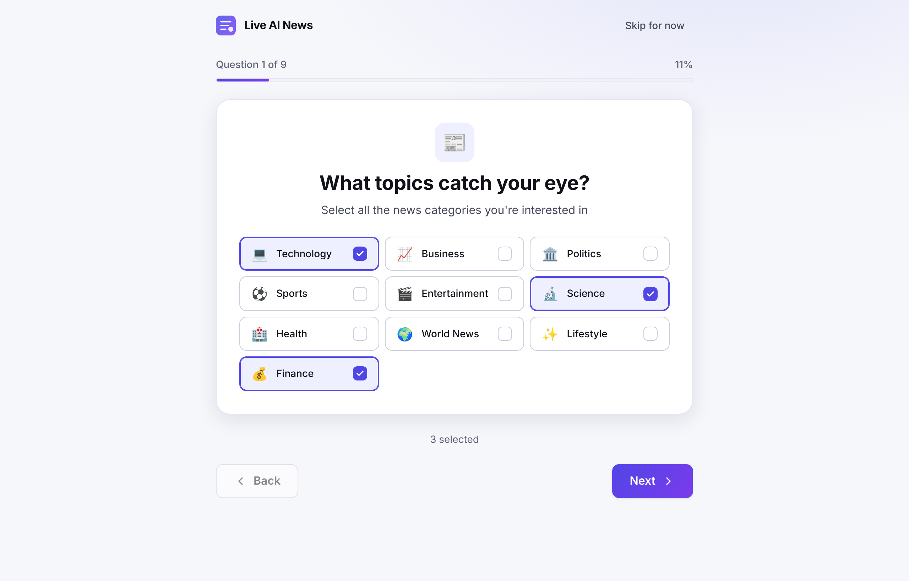
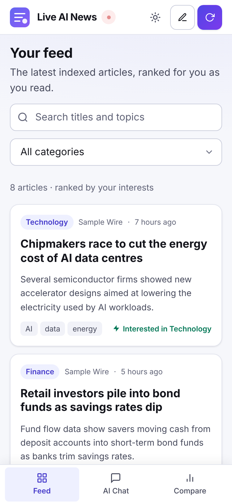
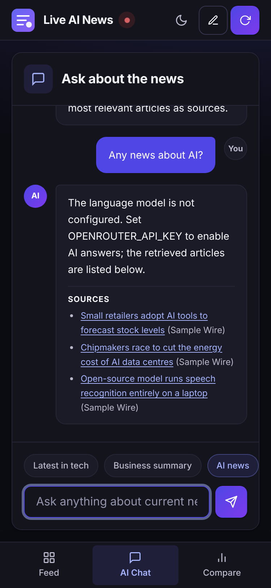
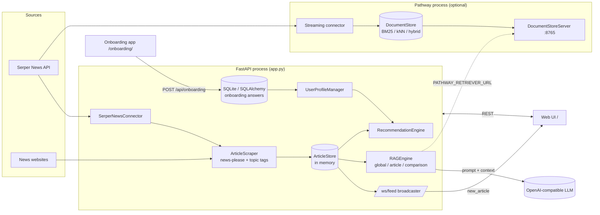

# Live AI News

**A live, personalised news feed you can talk to.** It discovers fresh articles, indexes them as they arrive, ranks them by what each reader cares about, and answers questions about them with sources.




## Contents

- [Overview](#overview)
- [Screenshots](#screenshots)
- [Features](#features)
- [Tech stack](#tech-stack)
- [Architecture](#architecture)
- [Project structure](#project-structure)
- [Getting started](#getting-started)
- [Configuration](#configuration)
- [Running](#running)
- [Usage](#usage)
- [Scripts and commands](#scripts-and-commands)
- [API reference](#api-reference)
- [Testing](#testing)
- [Linting and formatting](#linting-and-formatting)
- [Deployment](#deployment)
- [Troubleshooting and FAQ](#troubleshooting-and-faq)
- [Known limitations](#known-limitations)
- [Roadmap ideas](#roadmap-ideas)
- [Contributing](#contributing)
- [License and credits](#license-and-credits)

## Overview

Most "chat with the news" demos index a fixed snapshot and go stale within hours. Live AI News treats news as a stream instead:

1. It polls the [Serper](https://serper.dev) Google News API by category and scrapes the full text of each new article.
2. Each article goes into an index the moment it is scraped. No restart, no batch re-index. Open browsers are told about it over a WebSocket and refresh their feed.
3. Readers ask questions about everything indexed, about one article, or about how two articles compare. Answers come from an LLM grounded in the retrieved articles, and every answer lists its sources.
4. What a reader opens, chats about and compares updates their profile, so the feed re-ranks itself. Each ranking shows the reason behind it, for example "Interested in Finance".

**Who it's for:** people who want a quick, explainable way to follow several topics; developers looking for a working example of streaming RAG with [Pathway](https://github.com/pathwaycom/pathway), FastAPI and a plain-JavaScript front end; and hackathon teams who want a starting point that already handles ingestion, retrieval, personalisation and UI states.

The project began as an entry to the DataQuest 2026 "Live AI" hackathon (IIT Kharagpur), whose brief was a dynamic RAG application built on Pathway. See [`docs/hackathon-brief.md`](docs/hackathon-brief.md).

## Screenshots

All screenshots were captured from the running app with `python app.py --demo`. The demo articles are fictional samples (source "Sample Wire"), and no LLM key was configured, so chat shows the retrieved sources with the app's "AI answers are off" notice rather than a generated answer.

| Dark theme | Article dialog |
|---|---|
|  |  |

| AI chat with sources | Compare two articles |
|---|---|
|  |  |

| Onboarding questionnaire | Phone: feed | Phone: chat (dark) |
|---|---|---|
|  |  |  |

## Features

**News and retrieval**

- **Live ingestion.** Serper discovers URLs per category, [news-please](https://github.com/fhamborg/news-please) extracts the article text, and a keyword tagger adds topics. Run it on demand with the *Fetch news* button, or continuously with `--stream`.
- **Three chat modes over the index:**
  - *Global*: ask about everything indexed, optionally filtered by category.
  - *Article*: ask about one article, with context widened to related articles.
  - *Comparison*: compare two to five chosen articles.
- **Optional Pathway live index.** A Pathway `DocumentStore` (BM25, kNN or hybrid) fed by a streaming connector and served over HTTP. When `PATHWAY_RETRIEVER_URL` is set, global chat retrieves from it, and falls back to the built-in keyword retriever if Pathway is unreachable.
- **Works without keys.** Missing keys never crash the app. Fetching returns a clear `503`, and chat still returns the matching articles with a note that AI answers are off.

**Personalisation**

- Views, chats, likes and comparisons adjust per-reader category and topic scores. The feed is ranked by those scores plus freshness, and each card shows the personal reason it was ranked up.
- **Comparison suggestions.** Opening an article about one side of a rivalry (for example Tesla) suggests an article about the other (for example BMW).
- **Onboarding questionnaire.** A nine-question React app. The categories a reader picks seed their profile. Answers are stored in the database, so a returning reader is re-seeded.

**Interface**

- A single design system (spacing scale, type scale, colour tokens, radii) shared by the main app and the onboarding app.
- **Light and dark themes.** The app follows the OS setting, can be toggled from the header, and remembers the choice. The onboarding app uses the same preference.
- **Responsive layouts** tested at 375px, 768px and 1280px. On phones, the section navigation becomes a bottom tab bar and the article dialog becomes a bottom sheet.
- **A state for every request**: skeleton loading cards, empty and "no matches" states, errors with a retry button, toasts for background actions, inline validation for chat and compare, and a typing indicator while waiting for an answer.
- **Accessibility**: semantic landmarks and headings, labelled controls, visible focus rings, a skip link, a focus-trapped dialog that closes on Escape and returns focus, live regions for chat and results, `prefers-reduced-motion` support, and WCAG AA colour contrast. Every screen passes an automated [axe-core](https://github.com/dequelabs/axe-core) WCAG 2 A/AA audit in both themes.
- **Deep links**: `/#feed`, `/#chat` and `/#compare` open the matching section, and the back button works. Unknown pages get a styled 404 page.
- **Live updates.** Newly indexed articles are pushed over `/ws/feed`, and the header shows whether the live connection is up.

**Optional extras**

- **YouTube analysis**: finds related videos, transcribes one with Whisper, and summarises its key points and tone next to the article.
- **Demo mode**: `python app.py --demo` loads eight fictional sample articles, so you can try every screen without any API keys.

## Tech stack

| Layer | Technology |
|---|---|
| API server | Python 3.10+, FastAPI, Uvicorn, Pydantic v2 |
| Streaming index (optional) | Pathway `DocumentStore` (Tantivy BM25, brute-force kNN, hybrid) and `DocumentStoreServer` |
| LLM | Any OpenAI-compatible endpoint through the `openai` SDK (OpenRouter and `openai/gpt-4o` by default) |
| Ingestion | Serper API, news-please, httpx, BeautifulSoup, lxml |
| Persistence | SQLAlchemy 2 (SQLite by default; any SQLAlchemy URL) for onboarding answers |
| Main web UI | Plain HTML, CSS and JavaScript, with no build step, served by FastAPI at `/` |
| Onboarding UI | React 19 and Vite 7, built into `frontend/onboarding-app/dist` and served at `/onboarding/` |
| Video analysis (optional) | yt-dlp, ffmpeg, OpenAI Whisper |
| Tooling | pytest, Ruff (lint and format), ESLint |

## Architecture



How a request flows:

- **Ingestion.** `Services.ingest()` takes search results, scrapes them concurrently and adds each article to the `ArticleStore`. If the article is new, a `new_article` message goes to every `/ws/feed` client, and the browser reloads its feed after a one-second debounce.
- **Feed.** `GET /api/news/feed?user_id=…` asks the `RecommendationEngine` to score every article for that reader. The score combines category and topic preferences, freshness, and a penalty for already-read articles. The reasons are returned with each article.
- **Chat.** The `RAGEngine` retrieves the top articles: from the keyword index, or from Pathway when it's configured. It builds a mode-specific prompt and calls the LLM. Without an LLM key, it returns the retrieved articles with an explanatory message.
- **State.** Articles and reader profiles live **in process memory** and reset on restart. Onboarding answers are persisted and re-seed a profile when that reader returns.
- **Pathway.** The Pathway service runs its own Serper → scraper loop, so its index fills independently of the API's in-memory store. Article and comparison chat always use the in-process store, because they work from article IDs.

## Project structure

```text
.
├── app.py                       # CLI entry point: python app.py [--stream] [--demo]
├── config.py                    # Every setting, read from environment variables / .env
├── utils.py                     # Tokenising, topic parsing, timezone-aware UTC helpers
├── api/
│   ├── main.py                  # FastAPI app factory, REST routes, WebSockets, 404 handling
│   ├── services.py              # Wires the components together; ingestion workflow
│   ├── schemas.py               # Pydantic request models (validation and limits)
│   ├── demo_data.py             # Fictional sample articles for --demo
│   ├── database.py              # SQLAlchemy engine and session helper
│   └── db_models.py             # Onboarding answers table
├── connectors/
│   ├── news_connector.py        # Serper news discovery (per category, de-duplicated)
│   ├── article_scraper.py       # news-please extraction and keyword topic tagging
│   └── youtube_analyzer.py      # Video search, download, Whisper, LLM analysis (optional)
├── rag/
│   ├── article_store.py         # Thread-safe in-memory store and keyword retriever
│   └── rag_engine.py            # Global / article / comparison RAG and the Pathway client
├── user/
│   ├── user_profile.py          # Interaction tracking and preference scores
│   └── recommendation_engine.py # Personalised feed, related articles, comparison pairs
├── pipeline/
│   └── document_pipeline.py     # Pathway streaming connector and DocumentStore server
├── frontend/
│   ├── index.html               # Main UI markup (feed, chat, compare, article dialog)
│   ├── styles.css               # Design tokens, light/dark themes, components, layout
│   ├── app.js                   # Routing, API calls, rendering, states, live updates
│   ├── 404.html                 # Not-found page for unknown browser routes
│   ├── favicon.svg
│   └── onboarding-app/          # React + Vite questionnaire (served at /onboarding/)
│       └── src/                 #   App.jsx, App.css, index.css (shared tokens)
├── tests/                       # pytest suite (no network or keys needed)
├── docs/
│   ├── hackathon-brief.md       # Original hackathon problem statement
│   └── screenshots/             # Images used in this README
├── .env.example                 # Template for your .env
├── requirements.txt             # Runtime dependencies
├── requirements-dev.txt         # Runtime + pytest + ruff
├── requirements-youtube.txt     # Optional video-analysis dependencies
├── package.json                 # Convenience npm scripts (server, build, lint, test, dev)
└── pyproject.toml               # Ruff and pytest configuration
```

## Getting started

### Prerequisites

| Requirement | Needed for | Notes |
|---|---|---|
| Python 3.10–3.13 | Everything | The API and the Pathway pipeline |
| Node.js 20+ and npm | The onboarding app | Only to build or develop `/onboarding/`. The main UI needs no build |
| [Serper](https://serper.dev) API key | Live news and video search | Optional for trying the app (use `--demo`) |
| [OpenRouter](https://openrouter.ai) key, or any OpenAI-compatible endpoint | AI answers | Without one, chat returns sources only |
| `ffmpeg` | YouTube analysis | Optional |
| `OPENAI_API_KEY` | Pathway `knn` / `hybrid` retrieval | Optional; BM25 needs no key |

### Installation

```bash
# 1. Clone
git clone https://github.com/jeevithg090/rag-news-pathway.git
cd rag-news-pathway

# 2. Python environment
python -m venv .venv
source .venv/bin/activate            # Windows: .venv\Scripts\activate
pip install -r requirements-dev.txt  # runtime + pytest + ruff

# 3. Configuration
cp .env.example .env                 # then add your keys (all optional for --demo)

# 4. Onboarding app (optional, but needed for /onboarding/)
npm --prefix frontend/onboarding-app ci
npm run build                        # outputs frontend/onboarding-app/dist

# 5. Try it
python app.py --demo                 # open http://127.0.0.1:8000
```

Optional extras:

```bash
pip install -r requirements-youtube.txt   # YouTube analysis (also install ffmpeg)
npm install                               # root devDependency `concurrently`, for `npm run dev`
```

## Configuration

All settings are environment variables. They are also read from a `.env` file in the project root (see [`.env.example`](.env.example)). Nothing is required to start the server.

| Variable | Required? | Default | Description |
|---|---|---|---|
| `SERPER_API_KEY` | For live news | – | Serper key for news and video search. Without it, fetching returns `503` |
| `OPENROUTER_API_KEY` | For AI answers | – | Key for the LLM endpoint. Without it, chat returns sources only |
| `LLM_BASE_URL` | No | `https://openrouter.ai/api/v1` | Any OpenAI-compatible base URL |
| `LLM_MODEL` | No | `openai/gpt-4o` | Model name at that endpoint |
| `LLM_TEMPERATURE` | No | `0.7` | Sampling temperature |
| `LLM_MAX_TOKENS` | No | `2000` | Maximum tokens per answer |
| `LLM_TIMEOUT_SECONDS` | No | `60` | LLM request timeout |
| `HOST` | No | `127.0.0.1` | Bind address. Use `0.0.0.0` in containers |
| `PORT` | No | `8000` | HTTP port |
| `LOG_LEVEL` | No | `INFO` | Python log level |
| `CORS_ORIGINS` | No | `http://localhost:3000,http://127.0.0.1:3000` | Comma-separated browser origins allowed to call the API |
| `ADMIN_TOKEN` | No | – | Enables `POST /api/admin/clear-cache`; send it as the `X-Admin-Token` header. Admin routes are disabled when unset |
| `DATABASE_URL` | No | `sqlite:///./data/news_ai.db` | SQLAlchemy URL for onboarding answers |
| `DEMO_MODE` | No | `false` | Pre-load fictional sample articles at startup (same as `--demo`) |
| `NEWS_STREAMING_ENABLED` | No | `false` | Start background ingestion with the API (same as `--stream`) |
| `NEWS_FETCH_INTERVAL_SECONDS` | No | `300` | Delay between polling cycles |
| `NEWS_RESULTS_PER_CATEGORY` | No | `10` | Results requested per category per cycle |
| `NEWS_CATEGORIES` | No | `Finance,Technology,Science,Business,Health,Entertainment,Sports,Politics,World` | Categories to poll |
| `RAG_TOP_K` | No | `5` | Articles retrieved for global chat |
| `RAG_CONTEXT_CHARS` | No | `2000` | Characters of each article put into the prompt |
| `PATHWAY_RETRIEVER_URL` | No | – | Base URL of a running Pathway server, for example `http://127.0.0.1:8765` |
| `PATHWAY_HOST` | No | `127.0.0.1` | Bind address of the Pathway server |
| `PATHWAY_PORT` | No | `8765` | Port of the Pathway server |
| `OPENAI_API_KEY` | For `knn` / `hybrid` | – | Embeddings for Pathway vector retrieval. OpenRouter keys don't work here |
| `EMBEDDING_MODEL` | No | `text-embedding-3-small` | Embedding model for Pathway vector retrieval |
| `PREFERENCE_SCORE_INCREMENT` | No | `0.1` | How much one interaction raises a preference |
| `PREFERENCE_DECAY_FACTOR` | No | `0.95` | How fast old preferences fade |
| `WHISPER_MODEL` | No | `base` | Whisper model size for video transcription |
| `CACHE_DIR` | No | `./cache` | Where downloaded audio is cached |

## Running

### Development

```bash
python app.py --demo          # sample data, no keys needed
npm run server                # API with auto-reload (uvicorn api.main:app --reload)
npm run onboarding            # onboarding app on http://localhost:3000 (proxies /api to :8000)
npm run dev                   # both of the above together (needs `npm install` at the root)
```

The main UI is static, so edits to `frontend/index.html`, `styles.css` or `app.js` show up on a browser refresh.

### Production-style

```bash
python app.py                 # API + UI on HOST:PORT, ingestion on demand
python app.py --stream        # also poll Serper and index news in the background
```

`python app.py --help` lists every flag (`--host`, `--port`, `--stream` / `--no-stream`, `--demo`).

### With the Pathway live index

In a second terminal:

```bash
python -m pipeline.document_pipeline                       # BM25, no embedding key needed
python -m pipeline.document_pipeline --retriever hybrid    # BM25 + embeddings (OPENAI_API_KEY)
python -m pipeline.document_pipeline --no-chunking         # index whole articles (offline-friendly)
```

Then start the API pointing at it:

```bash
PATHWAY_RETRIEVER_URL=http://127.0.0.1:8765 python app.py
```

`GET /api/stats` reports `"retriever": "pathway"` when this is active.

## Usage

### In the browser

1. **Personalise (optional).** Open **Personalise** (or `/onboarding/`). Pick topics and answer the short questions; "Skip for now" goes straight to the feed.
2. **Fill the feed.** Click **Fetch news**. It fetches five articles from the category selected in the filter, or Technology by default. With `--stream`, new articles also arrive on their own, and the header shows **Live** while the live-update connection is up.
3. **Filter.** Search titles, summaries and topics, or pick a category. If nothing matches, use **Clear filters**.
4. **Read and ask.** Open a card to read the article, ask questions about it, see a suggested comparison, or find related YouTube videos.
5. **Ask across the news.** Open **AI Chat** and type a question, or tap a suggestion. Answers list their source articles.
6. **Compare.** Open **Compare**, choose two articles, optionally add a focus ("How do they differ on costs?"), and click **Compare**.
7. **Theme.** Use the sun/moon button to switch between light and dark.

### With the API

The examples below were run against `python app.py --demo` with no LLM key configured.

Personalised feed:

```bash
curl "http://127.0.0.1:8000/api/news/feed?limit=1&user_id=user_readme_demo"
```

```json
{
  "user_id": "user_readme_demo",
  "personalized": true,
  "articles": [
    {
      "article_id": "demo02",
      "title": "Chipmakers race to cut the energy cost of AI data centres",
      "category": "Technology",
      "source": "Sample Wire",
      "url": "https://example.com/sample/demo02",
      "topics": ["AI", "data", "energy"],
      "publish_date": "2026-11-14T15:59:52.269603+00:00",
      "description": "Several semiconductor firms showed new accelerator designs aimed at lowering the electricity used by AI workloads.",
      "image_url": null,
      "relevance_score": 1.0,
      "reasons": ["Interested in Technology", "Matches interests: AI, data, energy", "Fresh news"]
    }
  ],
  "count": 1
}
```

Global chat:

```bash
curl -X POST http://127.0.0.1:8000/api/chat/query \
  -H "Content-Type: application/json" \
  -d '{"query": "What is new in electric vehicles?"}'
```

```json
{
  "query": "What is new in electric vehicles?",
  "response": "The language model is not configured. Set OPENROUTER_API_KEY to enable AI answers; the retrieved articles are listed below.",
  "model": "openai/gpt-4o",
  "created_at": "2026-11-14T23:02:36.569177+00:00",
  "context": {
    "query": "What is new in electric vehicles?",
    "context_type": "global",
    "metadata_filter": null,
    "retriever": "keyword",
    "documents": [
      {
        "article_id": "demo07",
        "title": "Electric vehicle makers trim prices as battery costs fall",
        "source": "Sample Wire",
        "url": "https://example.com/sample/demo07",
        "snippet": "Several electric vehicle makers cut list prices this month, citing cheaper battery cells and higher factory output. …"
      }
    ]
  }
}
```

With `OPENROUTER_API_KEY` set, `response` contains the model's answer instead.

More requests:

```bash
# Fetch and index five Technology articles now (needs SERPER_API_KEY)
curl -X POST "http://127.0.0.1:8000/api/news/fetch?category=Technology&num_results=5"

# Ask about one article, widening context to related ones
curl -X POST http://127.0.0.1:8000/api/chat/article/demo07 \
  -H "Content-Type: application/json" -d '{"query": "Why are prices falling?", "expand_context": true}'

# Compare two articles
curl -X POST http://127.0.0.1:8000/api/chat/compare \
  -H "Content-Type: application/json" \
  -d '{"article_ids": ["demo07", "demo02"], "query": "How do they differ on costs?"}'

# Keyword search
curl "http://127.0.0.1:8000/api/news/search?query=battery&limit=5"

# Listen for new articles (any WebSocket client, e.g. websocat)
websocat ws://127.0.0.1:8000/ws/feed
```

Interactive OpenAPI docs are at `http://127.0.0.1:8000/docs`.

## Scripts and commands

| Command | What it does |
|---|---|
| `python app.py` | Start the API and web UI on `HOST:PORT` |
| `python app.py --stream` | Same, plus background Serper polling and indexing |
| `python app.py --demo` | Same, pre-loaded with fictional sample articles |
| `python -m pipeline.document_pipeline [--retriever bm25\|knn\|hybrid] [--no-chunking]` | Start the Pathway live indexing server |
| `npm run server` | API with auto-reload |
| `npm run server:prod` / `npm start` | `python app.py` |
| `npm run pathway` | `python -m pipeline.document_pipeline` |
| `npm run onboarding` | Vite dev server for the onboarding app on `:3000` |
| `npm run dev` | API and onboarding dev servers together (`concurrently`) |
| `npm run build` | Build the onboarding app into `frontend/onboarding-app/dist` |
| `npm run lint` | Ruff lint and format check, plus ESLint on the onboarding app |
| `npm run format` | Ruff format and auto-fix |
| `npm test` | `python -m pytest` |
| `npm run install:backend` / `install:frontend` / `install:all` | Install Python and/or onboarding dependencies |

## API reference

All endpoints return JSON. Only the admin endpoint needs authentication. `user_id` values are anonymous IDs that the browser generates (`^[A-Za-z0-9_.:-]{1,64}$`).

| Method | Path | Auth | Description |
|---|---|---|---|
| GET | `/health` | None | Liveness check with version and timestamp |
| GET | `/api/stats` | None | Index size, LLM and retriever status, recommendation and profile stats |
| GET | `/api/news/feed?user_id=&limit=&exclude_viewed=` | None | Latest articles; ranked with reasons when `user_id` is given |
| GET | `/api/news/article/{id}?user_id=` | None | Full article, related articles and a comparison suggestion (records a view) |
| GET | `/api/news/search?query=&category=&limit=` | None | Keyword search over indexed articles |
| POST | `/api/news/fetch?category=&num_results=` | None | Fetch, scrape and index now (`503` without `SERPER_API_KEY`) |
| POST | `/api/chat/query` | None | Global question: `{query, category?, user_id?}` |
| POST | `/api/chat/article/{id}` | None | Article question: `{query, expand_context?, user_id?}` |
| POST | `/api/chat/compare` | None | Compare: `{article_ids: [2..5], query, user_id?}` |
| POST | `/api/user/interaction` | None | Record `view`, `chat`, `compare`, `like` or `share` |
| GET | `/api/user/{id}/preferences` | None | Profile summary |
| GET | `/api/user/{id}/recommendations` | None | Ranked recommendations |
| POST | `/api/onboarding` | None | Save questionnaire answers (idempotent per user) |
| GET | `/api/onboarding/check/{id}` | None | Whether a user has completed onboarding |
| POST | `/api/youtube/search` | None | Find related videos: `{query, num_results?}` |
| POST | `/api/youtube/analyze` | None | Download, transcribe and analyse a YouTube video (YouTube URLs only) |
| GET | `/api/youtube/status` | None | Which optional video dependencies are installed |
| POST | `/api/admin/clear-cache` | `X-Admin-Token` | Clear scraper caches. Disabled unless `ADMIN_TOKEN` is set |
| WS | `/ws/feed` | None | Server pushes `{"type": "new_article", "article": {...}}`; send `ping` to get `pong` |
| WS | `/ws/chat/{session}` | None | Chat over a socket: `{query, type?, article_id?, article_ids?}` |
| GET | `/`, `/onboarding/`, `/docs` | None | Web UI, onboarding app, OpenAPI docs |

Errors use FastAPI's `{"detail": "..."}` shape: `422` for invalid input, `404` for unknown articles, `503` for missing keys, and generic messages for `500`s (details go to the server log). A browser requesting an unknown page (outside `/api`, `/ws` and `/static`) gets the HTML 404 page instead of JSON.

## Testing

```bash
python -m pytest              # or: npm test
python -m pytest -q tests/test_api.py -k onboarding   # run a subset
```

The suite has 73 tests and needs no network access or API keys. Serper, the scraper and the LLM are replaced with fakes. It covers:

- **Article store**: insertion and replacement, ordering, keyword ranking (topic, title, category and body hits), filters and stopwords.
- **RAG engine**: global, article and comparison modes; prompts and sources; the no-LLM and LLM-error paths; Pathway retrieval with fallback.
- **Personalisation**: interaction scoring and decay, feed ranking and reasons, related articles, comparison suggestions.
- **Connectors**: Serper parsing and de-duplication (mocked HTTP), news-please failure handling, topic tagging, YouTube URL validation and response parsing.
- **Pathway**: a real BM25 `DocumentStore` built on static tables.
- **API end to end**: REST routes, validation, WebSockets, onboarding round-trips, admin authentication, the HTML 404 page, and demo mode.

The UI was checked by hand and with Playwright scripts (not part of the repository) at 375px, 768px and 1280px in both themes. The scripts check for console errors and horizontal overflow, keyboard navigation, focus trapping in the dialog, form validation and the main flows, and run axe-core WCAG 2 A/AA audits.

## Linting and formatting

```bash
ruff check .                  # lint (rules in pyproject.toml)
ruff format --check .         # formatting check; `ruff format .` to apply
npm --prefix frontend/onboarding-app run lint   # ESLint for the React app
npm run lint                  # all of the above
```

## Deployment

The API is a standard ASGI app that also serves the UI, so a single process is enough.

```bash
pip install -r requirements.txt
npm --prefix frontend/onboarding-app ci && npm run build
HOST=0.0.0.0 PORT=8000 python app.py --stream
```

Checklist:

- **Run one worker.** Articles, profiles and the ingestion loop live in process memory. Several workers would each hold a different index.
- **Use TLS.** Put the app behind a reverse proxy (nginx, Caddy, a cloud load balancer) that terminates TLS and forwards WebSocket upgrades for `/ws/*`. The UI switches to `wss://` automatically on HTTPS.
- **Set `CORS_ORIGINS`** only if another origin calls the API. The bundled UI is same-origin.
- **Leave `ADMIN_TOKEN` unset** unless you need the admin endpoint. If you set it, use a long random value.
- **Persist onboarding data** by pointing `DATABASE_URL` at Postgres and installing a driver, for example `pip install psycopg2-binary`.
- **Pathway**: run `python -m pipeline.document_pipeline` as a second long-lived process and set `PATHWAY_RETRIEVER_URL`.
- **Health checks**: use `GET /health`.

## Troubleshooting and FAQ

**The feed is empty.**
Click **Fetch news** (needs `SERPER_API_KEY`), start with `--stream`, or run `python app.py --demo` to load sample articles.

**"Couldn't fetch news: SERPER_API_KEY is not configured".**
Add the key to `.env` and restart the server. Settings are read once at startup.

**Chat says "The language model is not configured".**
Set `OPENROUTER_API_KEY`, or point `LLM_BASE_URL` and `LLM_MODEL` at another OpenAI-compatible endpoint. The retrieved sources are still shown.

**`/onboarding/` returns "Onboarding app not built".**
Run `npm --prefix frontend/onboarding-app ci && npm run build`, then restart the server. It only mounts the build if it exists at startup.

**Fetching works, but few articles appear.**
Some publishers block scraping or return pages news-please can't parse. Those URLs are skipped and logged as warnings.

**The header says "Offline" instead of "Live".**
The WebSocket connection to `/ws/feed` dropped. The UI retries every five seconds. Behind a proxy, make sure WebSocket upgrades are forwarded.

**Pathway fails with a `tiktoken` download error.**
Chunking downloads an encoding on first use. Run with `--no-chunking` on offline machines.

**`--retriever knn` or `hybrid` fails.**
These need `OPENAI_API_KEY` for embeddings. OpenRouter keys don't work for the embedding endpoint. Use `bm25` otherwise.

**YouTube analysis fails.**
Check `GET /api/youtube/status`. You need `pip install -r requirements-youtube.txt` and `ffmpeg` on your `PATH`. Transcription can take a few minutes on a CPU.

**My personalisation disappeared.**
Profiles are kept in memory and reset on restart. Onboarding answers are stored in the database and re-seed your categories. Your ID lives in the browser's `localStorage`, so clearing site data or using another browser starts fresh.

**Port 8000 is already in use.**
Start with `python app.py --port 8001` or set `PORT`.

## Known limitations

- The API's article index and reader profiles are not persisted across restarts.
- Topic tagging uses a fixed keyword list, not NLP.
- There are no user accounts. Readers are anonymous browser-generated IDs.
- The built-in retriever is keyword-based. Semantic retrieval needs the Pathway service with `knn` or `hybrid`.
- The Pathway index and the API's in-memory store are filled by separate loops, so they can briefly differ.
- `pip-audit` flags a transitive dependency of Pathway (`diskcache`) with no fixed release yet.

## Roadmap ideas

- Use the Pathway `DocumentStore` as the single source of truth for the feed as well as retrieval.
- Persist articles and profiles (Postgres or Pathway persistence) so restarts keep state.
- Stream LLM answers token by token over `/ws/chat`.
- Replace keyword topic tagging with embeddings or an LLM classifier.
- Optional sign-in, so profiles follow a reader across devices.
- A container image and a compose file for the API, the Pathway service and Postgres.
- Commit the Playwright UI checks as an automated end-to-end test suite.

## Contributing

1. Fork the repository and create a feature branch.
2. Install the dev dependencies (`pip install -r requirements-dev.txt`, `npm --prefix frontend/onboarding-app ci`).
3. Make your change. Keep the main UI dependency-free, and reuse the design tokens in `frontend/styles.css` (mirrored in `frontend/onboarding-app/src/index.css`) rather than hard-coding colours or spacing.
4. Add or update tests, then run `npm run lint`, `npm test` and `npm run build`.
5. For UI changes, check phone (375px) and desktop widths in both themes, and use the keyboard to reach everything.
6. Open a pull request describing what changed and how you checked it. Use conventional commit messages (`feat:`, `fix:`, `docs:` …).

Never commit real API keys. `.env` is gitignored; put new settings in `.env.example` with blank values.

## License and credits

This repository is a fork of [**div-del/LIVE_LENS_rag_news_pathway**](https://github.com/div-del/LIVE_LENS_rag_news_pathway). The original authors built it as the DataQuest 2026 team (IIT Kharagpur) for the Megalith 2026 "Live AI" hackathon, and all credit for the original idea and implementation goes to them.

**License:** the upstream repository does not include a LICENSE file. `package.json` declares `"license": "MIT"`, but without a LICENSE file the terms are not formally stated. Ask the original authors before reusing the code beyond personal or evaluation use.

Built with [Pathway](https://pathway.com), the live data processing framework. News search by [Serper](https://serper.dev); article extraction by [news-please](https://github.com/fhamborg/news-please).
